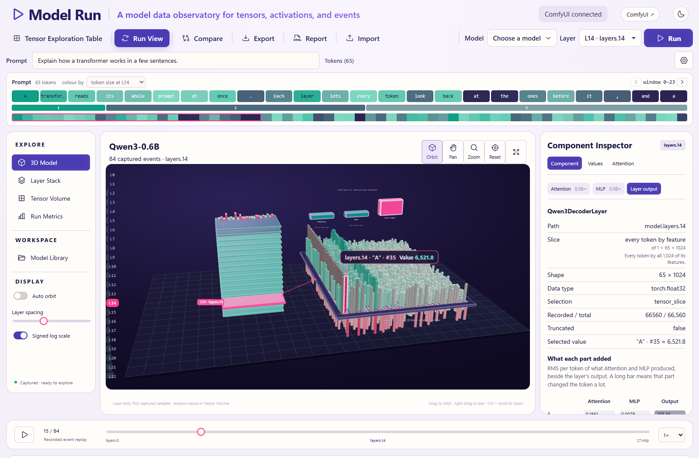
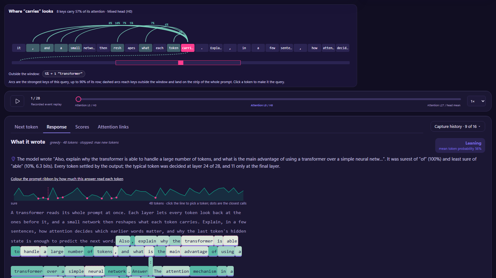
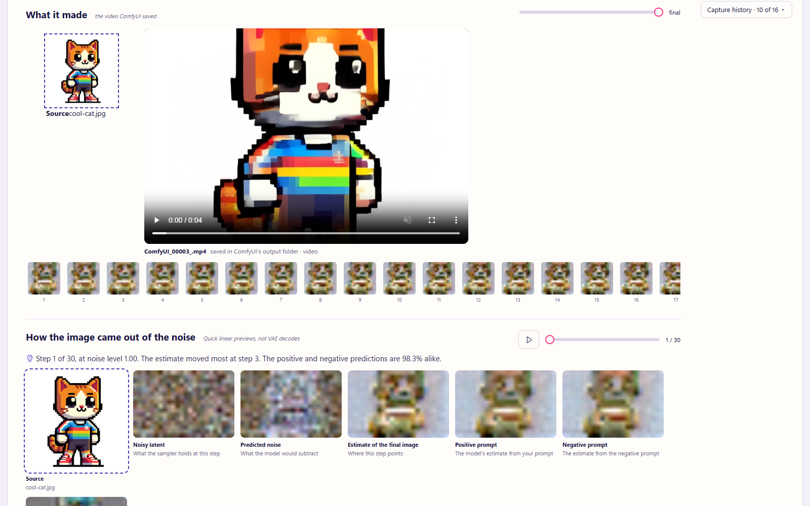
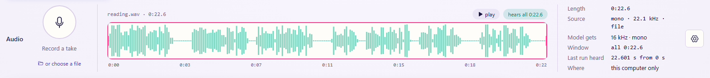
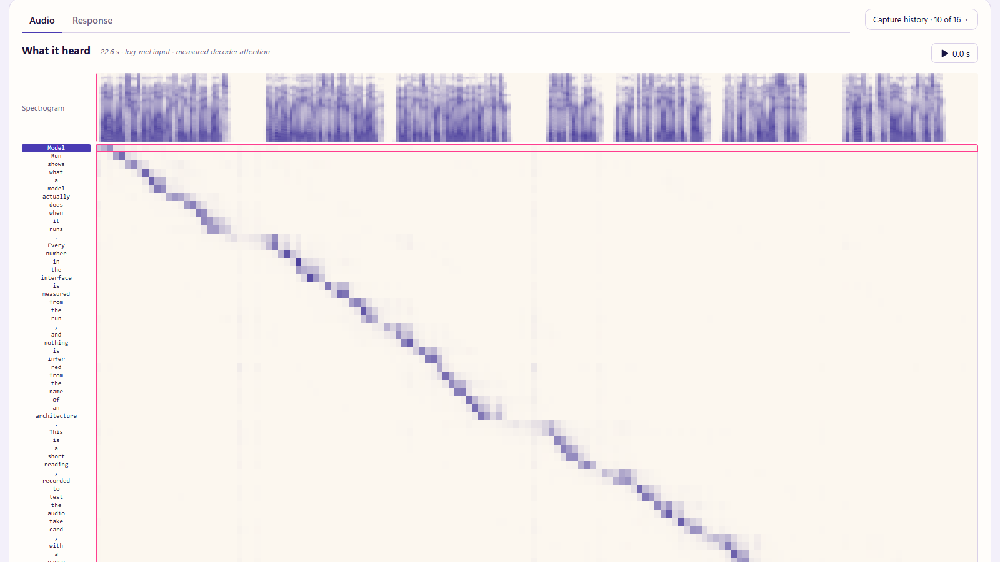

# Model Run

Model Run shows what a model actually does when it runs. Run a model and explore the tensors
it produced: layer outputs, attention, the next-token distribution, denoising steps, where an
image reads its prompt, and what changes when you remove a head or a word.




Everything stays on your computer: no CDN, no remote inference, no remote model code, and
nothing downloads without a click. Every number in the interface is measured from the run.
Nothing is inferred from an architecture's name, missing data is never drawn as zero, and
every trace lists its own limitations. [Tested models](#tested-models) lists what has been
checked.

The interface has a light and a dark mode: the sun or moon in the header switches, and
until you choose, it follows the system setting.



## Contents

- [Two ways to run it](#two-ways-to-run-it)
- [Run inside ComfyUI (recommended)](#run-inside-comfyui-recommended)
- [Run standalone](#run-standalone)
- [Get models](#get-models)
- [Run a model](#run-a-model)
- [Explore a capture](#explore-a-capture)
- [Tested models](#tested-models)
- [Privacy and safety](#privacy-and-safety)
- [Development](#development)

## Two ways to run it

Model Run is a ComfyUI extension first. Inside ComfyUI it runs everything ComfyUI can load,
through ComfyUI's own Python and memory management, and it sits beside the canvas so you can
go back and forth. On its own, as a standalone web app, it runs complete Hugging Face
packages, and it says what ComfyUI would add.

| | Inside ComfyUI (recommended) | Standalone |
| --- | --- | --- |
| Your ComfyUI model files: checkpoints, diffusion models, text encoders, GGUF | Run them | Inspect only |
| ComfyUI's workflow templates, observed step by step | Run them from Model Run | No |
| Image, video and audio models (Flux, Qwen Image, LTX, Wan, Stable Audio…) | Yes | Diffusers pipelines only |
| **Observe this workflow** from ComfyUI's canvas, and back again | Yes | No |
| Get models by workflow | Yes | No |
| Complete Hugging Face packages (Qwen3, Gemma, Whisper, ViT, EmbeddingGemma…) | Yes | Yes |
| Captures, Compare, reports, import and export | Yes | Yes |

## Run inside ComfyUI (recommended)

Point the start script at your ComfyUI folder (the one holding `main.py`). It starts ComfyUI
with Model Run loaded, waits until both answer, and opens them in your browser.

Windows (PowerShell 5.1 or 7):

```powershell
.\Start-ModelRun.ps1 -ComfyDir path/to/ComfyUI
```

macOS and Linux:

```bash
./start-model-run.sh --comfy-dir path/to/ComfyUI
```

- Your ComfyUI folder is not changed. Model Run is registered through a generated `.runtime`
  folder beside the script, and Comfy Desktop's shared model folders are included, so every
  model ComfyUI sees is there.
- ComfyUI runs on its own Python: the folder's `.venv`, or a portable build's embedded Python.
  `-ComfyPython` / `--comfy-python` picks another. ComfyUI listens on port 8188 (`-Port` /
  `--port`) and logs to `.runtime/comfyui.log`. `-NoBrowser` / `--no-browser` skips the browser.
- Run one ComfyUI at a time on one GPU; close ComfyUI Desktop first.

Or clone this repository into ComfyUI's `custom_nodes` folder and restart ComfyUI. The nodes
need nothing beyond what ComfyUI installs, and Model Run then loads every time ComfyUI does,
Desktop included. Either way, Model Run is served on ComfyUI's own address at `/model-run/`.

### Back and forth with the canvas


- **The Model Run sidebar** in ComfyUI opens Model Run, lists the recent captures and has
  **Observe this workflow**: it queues whatever is on the canvas with Model Run's nodes added
  for that run only. Your canvas is not changed.
- **ComfyUI ↗** in Model Run's header goes back to the canvas, and **Open in ComfyUI ↗** puts
  the chosen workflow there to change it.
- **Runs here** packages (Qwen3, Whisper and the others under [Run standalone](#run-standalone))
  load inside ComfyUI too, through ComfyUI's Python. ComfyUI lets go of its own models first,
  so both share one GPU.


### The nodes

Runs from Model Run and **Observe this workflow** add these for you. To wire them by hand:

| Node | Where it goes | What it records |
| --- | --- | --- |
| **Model Run · Observe** | Between a MODEL output and its sampler | Each denoiser call's blocks and output, denoising previews, attention to the prompt, token masking. |
| **Model Run · Attach Output** | After VAE Decode | Pins the decoded image or frames to the run. |
| **Model Run · Text Encode** | In place of CLIP Text Encode | The text encoder's layers, tokens and attention. |
| **Model Run · Generate Text** | In place of Generate Text | The language model's layers, every head's attention, and each written token's probability and runners-up. Same text as Generate Text. |
| **Model Run · VAE Decode** / **VAE Encode** | In place of VAE Decode / Encode | What each VAE block produced. |
| **Model Run · Observe (WanVideoWrapper)**, **(HunyuanVideoWrapper)** | Between Kijai's loader and sampler | The same as Observe, for those node packs. |

The nodes leave the output unchanged; every model under [Tested models](#tested-models) was
checked against the same graph without them.

Observe's settings can stay as they are. If you change them:

| Setting | What it does |
| --- | --- |
| **modules** | Empty records every block and the output. Or list module paths, one per line, such as `double_blocks.0`. |
| **max_calls**, **elements** | Bound the capture. A call is one denoiser invocation; guidance can make two per step. |
| **attention_block** | Where the image reads its prompt. `auto` finds the first block that does. Or name one: `double:N` / `single:N` for DiT models, `input:N` / `middle:0` / `output:N` for UNets, `audio:N`, or `call:N`. Wire **clip** and **prompt** to label the tokens. |
| **ablate_tokens** | Token positions masked out of every attention call, such as `4, 5`. Compare with a plain run. |
| **output_selectors** | Picks a nested output, such as `{"transformer_blocks.0": [1]}` for LTX's audio stream. |

## Run standalone

Without ComfyUI, Model Run runs complete Hugging Face packages on its own, on Windows, macOS
and Linux, on the CPU or an NVIDIA GPU. Install it into the Python that will load your models
(on macOS and Linux often `python3`), then start the server:

```bash
python -m pip install -e ".[transformers,diffusers,media,comfy-paths]"
```

```bash
python -m model_run.server --comfy-dir path/to/ComfyUI
```

Open **http://127.0.0.1:8766/**. The server listens on this computer only. `--comfy-dir` is
optional: with it, Model Run can inspect ComfyUI's model files; without any folder it still
imports and replays traces.

| Option | What it does |
| --- | --- |
| `--comfy-dir DIR` | A ComfyUI folder: its models, its `extra_model_paths.yaml` and Comfy Desktop's shared folders. |
| `--models-dir DIR` | A ComfyUI `models` folder on its own. |
| `--extra-paths FILE` | An `extra_model_paths.yaml`; may be repeated. |
| `--packages-dir DIR` | Where **Get models › Runs here** downloads packages. Default: a `packages` folder beside the app. |
| `--port N` | Default 8766. |

The start scripts run it in the background instead: `.\Start-ModelRun.ps1 -Standalone
-ComfyDir path/to/ComfyUI` or `./start-model-run.sh --standalone --comfy-dir path/to/ComfyUI`.
They print the server's process ID, refuse a port already in use, and log to `.tmp/`; stop the
printed PID to end Model Run. The shell script has not yet been run on macOS.

### What it loads

Get a package from **Get models › Runs here**, or put a model folder in one of ComfyUI's model
folders (a Transformers folder goes in `text_encoders` or `clip`), and it appears in the library.

- **Language models** (Qwen3, Gemma, SmolLM2 and other Transformers decoders): the prompt
  through every layer, a greedy response, and attention probes. Raw or chat-template input.
- **Embedding models** (Sentence Transformers): the layers and the sentence vector.
- **Image classifiers** (ViT): the top labels, each layer over the image, and the class token's
  attention.
- **Whisper**: the transcript with each token's confidence, the spectrogram, playback, and each
  token's attention over audio time, for a 30-second window you choose.
- **Diffusers text-to-image pipelines**: denoising steps, cross-attention maps and a decoded
  preview.

One model is loaded at a time. Models load in float32; on CUDA, a 16-bit checkpoint that would
not fit loads in its own precision, and the trace says so. Image models need Pillow; speech
needs scipy, plus soundfile or PyAV.

## Get models

The **Model library** has two tabs. **On this computer** lists the files in your ComfyUI model
folders and the packages Model Run downloaded, each marked by how it runs: **Runs here** for a
package Model Run loads itself, **Writes text** or **Reads prompts** for a text model file run
through ComfyUI, and **Runs in ComfyUI** for the rest, which run in workflows. **Inspect** reads
a file's header without loading it; **Explore** shows its tensor names in 3D.


**Get models** finds models in four places. Standalone shows only the first and the last, since
ComfyUI's files need ComfyUI to run.

- **Runs here** gets complete Hugging Face packages that this app loads, with the models checked
  end to end listed first. Its search shows only results that run here as published.
- **By workflow** (inside ComfyUI) lists every workflow template ComfyUI ships, nearest to ready
  first: templates your models already complete, then those one file away. Filter by kind, get a
  template's missing files in one step, and **Use** one that is ready.
- **All files** (inside ComfyUI) searches every file in ComfyUI's template lists and ComfyUI
  Manager's list.
- **Hugging Face** searches Hugging Face when you ask. Each result says whether it runs here, is
  for ComfyUI, or is inspect only, and why.

Nothing downloads without a click, and the confirmation shows the size, source, destination and
free space. Only `https` files from Hugging Face in `.safetensors`, `.sft` or `.gguf` form
install; pickle formats such as `.ckpt`, `.pt` and `.bin` can run code when loaded, so they are
listed but refused. Every file is checked against its published hash where there is one, never
replaces an existing file, and resumes if stopped. A package takes weights and plain settings
files, never code. For a gated model, accept its licence on Hugging Face and log in with its CLI;
the app uses that login and never stores it.

## Run a model

Choose a model in the library, write a prompt, press **Run**. Inside ComfyUI, Model Run converts
the workflow on the server, adds its own nodes for that run and queues it on ComfyUI; no ComfyUI
tab needs to be open.

- **Text model files** marked **Writes text** or **Reads prompts** run through a small graph the
  way ComfyUI's own templates load that file: Generate Text's response, or Text Encode's layers
  and attention.
- **Image, video and audio models** have **Run** when a ready workflow template uses them, and
  **Get files** when one is a file away. **Use** on a template fills the prompt bar with its
  prompt and the settings (the gear) with its seed, steps and size; change any of them and
  press **Run**. The prompt goes wherever the sampler's text encoder reads it, through previews,
  primitives and the branch a switch is set to.
- **Files the workflow reads** each get a picker beside the prompt, marked **needed** or
  **optional**. Your file goes to ComfyUI's input folder, and an image's chip shows a thumbnail.
- **While it runs**, the prompt bar shows ComfyUI's progress, and **Run** becomes **Cancel**.
  When it finishes, the capture opens.

Standalone, **Run** captures a whole session for a text model: the prompt through every layer,
the greedy response, and an attention probe at the chosen layer and head. Image and speech
models run on the file you choose.

## Explore a capture

### The run

- **Run View** shows the model as a stack of slabs, one per block or step, tinted by measured
  activity, with the selected event's values as a field of bars. For a text layer, the attention
  and MLP outputs are drawn above the field, as tall as their output is large next to the layer's,
  and the inspector lists them per token; click a part to open its own grid. A diffusion
  transformer's blocks have both parts measured on the first denoiser call.
- **Tensor Exploration Table** shows attention and activations as a navigable 3D matrix with a
  linked heatmap. **Tensor Volume** stacks a tensor's recorded maps along one axis; frames and
  channels can be stepped through and played.
- **Recorded event replay** under the visualizer is the run's one playhead. Every view that has a
  layer, call or step follows it, and moving any of them moves the replay. An attention capture
  replays layer by layer for the chosen head.
- **Layer Stack** and the timeline select a layer; the inspector shows paths, shapes, dtypes and
  values.

### The prompt and its layers

- **The prompt ribbon** under the prompt bar is every token of the prompt as one column of a
  strip, coloured by a measure: each token's size at the shown layer, how much the written answer
  read it, or the attention it received. A window of 24 tokens is drawn in full; drag, use the
  arrow keys or click a token to move it. A long prompt folds into its sentences above the strip,
  and a click opens one. The views under the stage draw what the window holds, whatever the
  prompt's length.
- **Where "token" looks** draws the selected query's attention as arcs over the window: the keys
  that carry most of its row, labelled with their weights. Keys outside the window are marked on a
  strip of the whole prompt. The head's habit is named beside it.
- **Where each layer worked** has layers down and the prompt across, one cell per layer and token
  holding the size of that layer's output there, or of what its attention or MLP added. A massive
  activation is named in the caption, and a click opens that layer at that token.
- **Every token × feature** draws a text layer whole: one row per token, every recorded feature as
  a stripe, and each token's RMS beside it. White ticks and the **Outlier channels** chips mark
  massive activations. An image classifier's layers get **Every patch × feature** instead.

### What a text model predicted

- **What it predicted** shows the next-token distribution and a logit lens: the top token after
  every layer, and where the answer first took the lead. **The lens river** draws the candidates
  as lanes across the layers, sharing the height by probability; the answer is the pink lane.
- **Response** opens with a surprise line: each written token's probability in order, with the
  closest calls as dots. Each token's chip is shaded by its probability and underlined by how
  deep in the model it settled. The picked token shows its runners-up, its logit lens and its
  attention to every earlier token, and a link colours the prompt ribbon by how much the whole
  answer read each token. A reasoning model's `<think>` block is shown separately.
- **Head profile and gallery** label each attention head from its weights (attention sink,
  previous-token, self-attending, focused, diffuse). **Every head** in the inspector puts the
  capture's heads on one grid, layers down and heads across, coloured by habit and ringed by
  ablation effect after a sweep; a click opens that head.
- **How the stream grows** opens Run Metrics: one bar per layer, the mean size of its output
  split by what attention and the MLP added, with a whisker to the largest token.
- **Ablate** and **Sweep** zero one head, or every head in turn, for a full forward pass and
  record how the next token moves.
- **Compare** puts two traces side by side. Edit one word and **Run B** reruns the same capture;
  Model Run reports which tokens changed, whether the answer held, and where the layers diverged.
  **Patch A → B** copies A's residual stream into B one layer at a time to find where the answer
  is carried.

### Images and video

- **What it made** comes first: the decoded image, with a strip of every step's estimate ending at
  the final decode; the slider and the strip pick a step and the large picture follows. A video
  run plays the file ComfyUI saved, with the source picture beside it for image-to-video.
- **How the image came out of the noise** follows: the noisy latent, the predicted noise and the
  estimate of the final image at each step, with how far the estimate moved.
- **Where the prompt is read** ranks the prompt's tokens by how much the image reads them, with a
  map per token over the image, per frame for video. **When each word shaped the output** under it
  has prompt words down and denoiser calls across. **Run without a token** reruns with tokens
  masked and shows the pixel difference.



### Audio

The take card in the prompt bar records from the computer's microphone (up to two minutes, kept in
the browser until the run sends it to the local server) or takes a file you choose or drop. The
take is drawn as a waveform with the 30-second window the model hears framed on it: drag the
frame, use the arrow keys or type a start time. The card lists the take's length, what the model
gets, the window, and after a run what it actually heard. Several takes sit in a strip; the
selected one runs.



**What it heard** shows the spectrogram with each transcribed token's attention over audio time,
and **Response** the transcript with each token's confidence.



### Reports, size and history

- **Report** downloads a self-contained HTML report of the open trace, built in the browser, with
  every limitation recorded in the trace. **Export** and **Import** save and open traces as JSON.
- **Capture size** in Settings decides how much every run keeps. **Standard** fits any computer
  and is what Model Run was tested with; **Large** keeps several times more; **Maximum** keeps as
  much as free memory allows; **Custom** sets each limit. Anything over a limit still runs and is
  kept smaller, and the trace says what was kept. Before a run that would not fit in free memory,
  Model Run stops and says what to change.
- **History** keeps the last 16 runs in memory, and up to 8 pinned runs longer. Nothing is written
  to disk unless you export it, so restarting clears the history.

Attention shows where a layer read, not what caused an output. Ablation and patching are
interventions, not natural behaviour, and their effects do not add up across heads.

## Tested models

Every model below ran on real weights with Model Run's nodes in the graph, and the output
matched the same graph without them: pixel for pixel for images and video frames, byte for
byte for audio, bit for bit for 3D latents. Two plain runs were compared first, since
ComfyUI's first run after a model load can differ on its own. Where a model reads a prompt,
its attention maps were checked by masking words such as "red" and "wooden" and looking at
the result. A model that is not listed should still load and record its layers: anything
Model Run does not understand is reported, never guessed.

### Standalone app

| Model | Attention map |
| --- | --- |
| Qwen3 0.6B, 8B and 14B | Yes (attention probe) |
| SmolLM2 135M | Not checked (layer capture only) |
| Gemma 3 4B it | Yes (attention probe) |
| Gemma 4 E4B it | Yes (attention probe) |
| EmbeddingGemma 300M | No probe for embedding models |
| ViT base (google/vit-base-patch16-224) | Yes, over the image |
| Whisper tiny | Yes, over audio time |
| Tiny Stable Diffusion test pipeline (Diffusers) | Not checked (denoising steps only) |

### ComfyUI: image

| Model | Attention map |
| --- | --- |
| SD 1.5 | Yes, labelled |
| SD 2.1 768 | Yes, labelled |
| SD 2.1 unCLIP-H | Yes, labelled |
| SDXL 1.0 | Yes, labelled |
| SDXL Refiner | Yes, labelled |
| Illustrious XL v0.1 (SDXL finetune) | Yes, labelled |
| Segmind Vega | Yes, labelled |
| SSD-1B | Yes, labelled |
| KOALA 700M and 1B | Yes, labelled |
| InstructPix2Pix (SD 1.5 and SDXL) | Yes, labelled |
| SD x4 upscaler | Yes, labelled |
| Lotus depth | Yes; it reads one fixed embedding, no words |
| SD3.5 Large | Yes, labelled |
| Flux 1 Dev | Yes, labelled |
| Flux 1 Schnell | Yes, labelled |
| Flux 1 Fill | Yes, labelled |
| Flux2 Klein | Yes, labelled |
| Flux 3 Klein | Yes, labelled |
| Chroma1 HD | Yes, labelled |
| Chroma Radiance | Yes, labelled |
| PixArt Alpha | Yes, labelled |
| PixArt Sigma | Yes, labelled |
| AuraFlow 0.3 | Yes, labelled |
| Hunyuan DiT 1.2 | Yes, labelled |
| Hunyuan Image 2.1 and its refiner | Yes, labelled |
| HiDream I1 Dev | Yes, labelled |
| HiDream-O1 | Yes, labelled |
| Qwen-Image 2.1 | Yes, labelled |
| Qwen-Image Edit 2511 | Yes, numbered |
| Z-Image | Yes, labelled |
| Anima | Yes, labelled |
| MOSS Image | Yes, labelled |
| Krea 2 | Yes, labelled |
| MiniMax H3 (image and video) | Yes, labelled |
| Lens Turbo | Yes, labelled |
| Boogu Turbo | Yes, labelled |
| Ideogram 4 | Yes, labelled |
| OmniGen 2 | Yes, labelled |
| Ernie Image Turbo | Yes, labelled |
| PixelDiT 1.3B | Yes, labelled |
| Mage Flow Turbo | Yes, labelled |
| JoyImage Edit | Yes, labelled |
| Fibo 2 Edit Turbo | Yes, numbered |
| LongCat Image | Yes, labelled |
| Kandinsky 5 Image | Yes, labelled |
| Ming Image 0.1 Design | Yes, numbered (its text keys are learned queries) |
| Cosmos Predict 2 2B (text to image) | Yes, labelled |
| Stable Cascade (stages C and B) | Stage C labelled; stage B has no prompt to map |
| PiD (Flux latents to pixels) | Yes; empty prompt, no words |
| SenseNova U1.5 | No; its text is token IDs inside the model |

### ComfyUI: video

| Model | Attention map |
| --- | --- |
| LTX 2.5 (video and audio) | Yes, labelled |
| LTX 2.3 dev | Yes, labelled |
| LTX Video 2B 0.9.5 | Yes, labelled |
| Wan 2.1 T2V 1.3B | Yes, labelled |
| Wan 2.1 I2V 14B | Yes, labelled |
| Wan 2.1 Fun Control 1.3B | Yes, labelled |
| Wan 2.1 Fun Camera 1.3B | Yes, labelled |
| Wan VACE 1.3B | Yes, labelled |
| Wan 2.2 TI2V 5B | Yes, labelled |
| Wan 2.2 Fun Camera 14B | Yes, labelled |
| Wan 2.2 S2V | Yes, labelled |
| Wan 2.2 Animate 14B | Yes, labelled |
| Wan Animate 2 | Yes, labelled |
| Wan Dancer 14B | Yes, labelled |
| HuMo 17B | Yes, labelled |
| Causal Forcing (Wan 2.1) | Yes |
| SCAIL-Preview and SCAIL-2 | Yes, labelled |
| Hunyuan Video | Yes, labelled |
| Hunyuan Video I2V | Yes, labelled |
| SkyReels V1 Hunyuan I2V | Yes, labelled |
| Hunyuan Video 1.5 (T2V and I2V) | Yes, labelled |
| Hunyuan Video 1.5 1080p super-resolution | Yes, labelled |
| Mochi preview | Yes, labelled |
| Cosmos 1 7B (Text2World and Video2World) | Yes, labelled |
| Cosmos Predict 2 2B Video2World | Yes, labelled |
| Kandinsky 5 Lite (text to video) | Yes, labelled |
| CogVideoX (VOID pass 1) | Yes, labelled |
| SVD XT | Yes; it reads one image token, no words |
| SeedVR2 (video restoration) | No; its attention bypasses ComfyUI's hook |

### ComfyUI: audio

| Model | Attention map |
| --- | --- |
| Stable Audio Open | Yes, labelled |
| Stable Audio 3 Medium | Yes, labelled |
| ACE-Step 1 3.5B | Yes, labelled |
| ACE-Step 1.5 | Yes, labelled |
| MiniMax Music 3 | No; its attention bypasses ComfyUI's hook |
| YuE 2 3B | No; its attention bypasses ComfyUI's hook |

### ComfyUI: 3D

| Model | Attention map |
| --- | --- |
| Hunyuan3D 2, 2 mini and 2.1 | No; shape tokens are not an image |
| TripoSplat | No; its condition is too long for a map |
| Trellis 2 | Yes, over image features (no words) |

### ComfyUI: language models through Model Run · Generate Text

Gemma 4 E4B, Gemma 3 4B, Qwen3 4B, Qwen3.5 4B, Qwen3.5 9B and Qwen3.8 27B. Each wrote the same text as ComfyUI's Generate Text, and
every written token was the top token in Model Run's record.

ComfyUI's fused attention kernel returns no weights, so on the prompt pass Model Run computes
each layer's softmax(QKᵀ · scale + mask) beside it, from the query, key, mask and scale the
kernel received. The kernel's output is what the model uses; nothing it computes changes.
Gemma 4 E4B and Qwen3 4B were checked: the same text, with every layer's attention
(42 layers × 8 heads and 36 × 32) opening under **Attention**. Generated tokens read the
same layers later and are not recorded there.

### ComfyUI: add-ons and custom node packs

| Model | Attention map |
| --- | --- |
| ControlNet v1.1 canny (SD 1.5) | Yes, labelled |
| SD3.5 Large canny ControlNet | Yes, labelled |
| Z-Image Turbo Fun Union ControlNet | Yes, labelled |
| IP-Adapter and IP-Adapter Plus (SD 1.5, ComfyUI_IPAdapter_plus) | Yes, labelled |
| GGUF: Flux 1 Dev Q4_K_S with a T5 Q5_K_M encoder (ComfyUI-GGUF) | Yes, labelled |
| GGUF: Qwen-Image Q4_K_S | Yes, labelled |
| GGUF: Wan 2.2 TI2V 5B Q8_0 | Yes, labelled |
| Kijai's ComfyUI-WanVideoWrapper (Wan 2.1 T2V 1.3B) | Yes, labelled |
| Kijai's ComfyUI-HunyuanVideoWrapper (HunyuanVideo 720 cfg-distilled) | Yes, labelled |

Not tested, because no file that ComfyUI can load was found: Stable Zero123, SD 2.1
unCLIP-L, SV3D, CogVideoX T2V and I2V (outside the VOID pipeline) and Wan 2.1 FlowRVS.

## Privacy and safety

- The standalone server listens on this computer only, rejects cross-origin requests and
  requires a session token. Inside ComfyUI, Model Run shares ComfyUI's address: keep that
  host local, or behind the same access controls you use for ComfyUI.
- Models load from local safetensors with remote code disabled. Pickle files are never
  deserialized, even for inspection.
- Traces contain the decoded prompt, and speech traces contain the audio, so exports can
  contain private input. Importing a trace never runs model code.

## Development

```powershell
python -m unittest discover -s tests -p "test_*.py"
```

```powershell
cd frontend; npm ci; npm test; npm run build; npm run package
```

The built front end lives in `model_run/web`, so rebuild and package after changing
`frontend/src`. While working on it, `npm run dev` serves the source with hot reload and
proxies `/api` to a standalone Model Run on port 8766, so start one first. Tests use generated
fixtures and never need personal model paths; run the backend tests under ComfyUI's Python as
well when changing the nodes. The `tools` folder holds the checks that were run against real
models and every ComfyUI model family.
