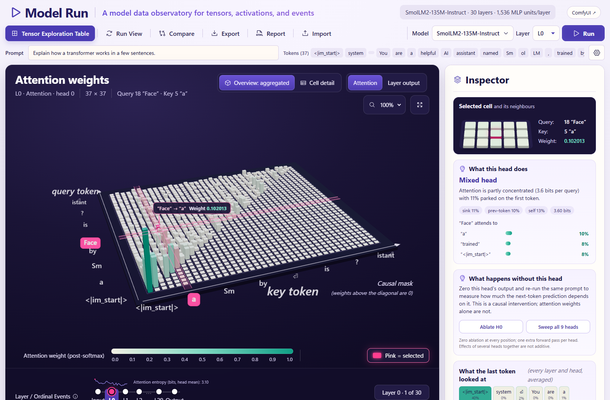
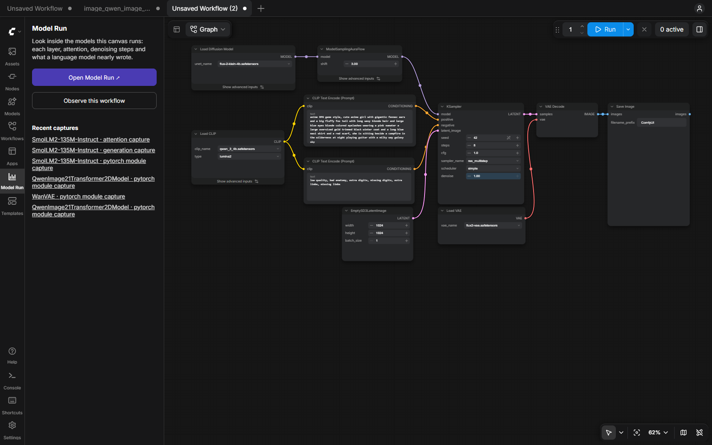
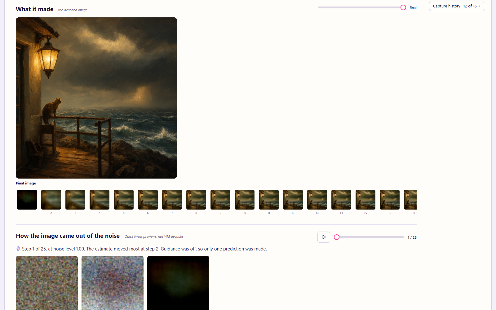
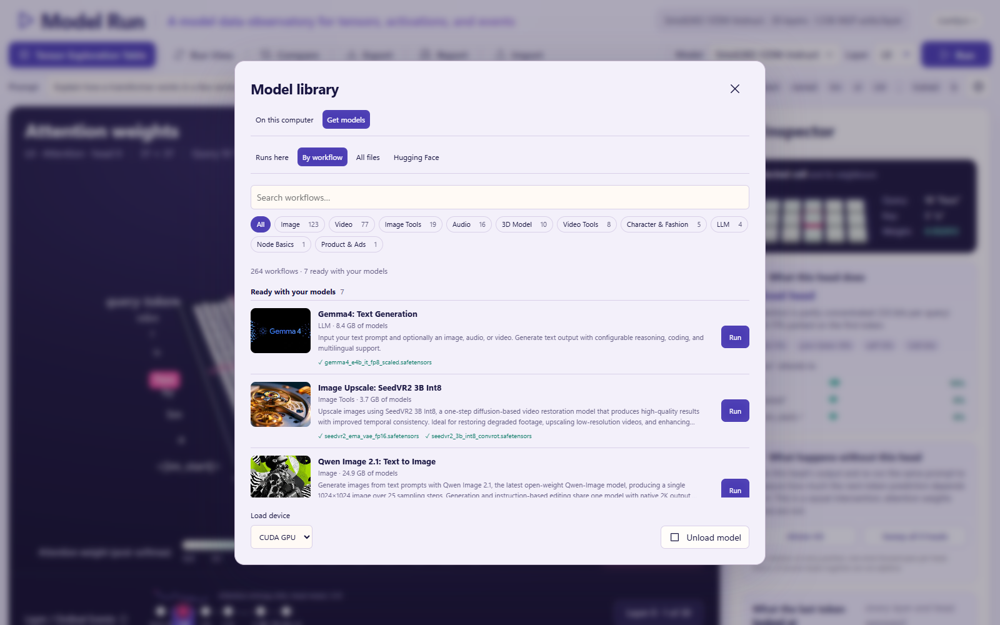

# Model Run

Model Run shows what a model actually does when it runs. Run a model and explore the tensors
it produced: layer outputs, attention, the next-token distribution, denoising steps, where an
image reads its prompt, and what changes when you remove a head or a word.



Everything stays on your computer: no CDN, no remote inference, no remote model code, and
nothing downloads without a click.

Every number in the interface is measured from the run. Nothing is inferred from
architecture names, missing data is never drawn as zero, and every trace lists its own
limitations. [Tested models](#tested-models) lists what has been checked and how.

The interface has a light and a dark mode: the sun or moon in the header switches, and
until you choose, it follows the system setting.

## Contents

- [Two ways to run it](#two-ways-to-run-it)
- [Run inside ComfyUI (recommended)](#run-inside-comfyui-recommended)
- [Run standalone](#run-standalone)
- [Get models](#get-models)
- [Explore a capture](#explore-a-capture)
- [Tested models](#tested-models)
- [Privacy and safety](#privacy-and-safety)
- [Development](#development)
- [Python API](#python-api)

## Two ways to run it

**Run Model Run inside ComfyUI.** It is a ComfyUI extension first: inside ComfyUI it runs
everything ComfyUI can load, through ComfyUI's own Python, loaders and memory management,
and it sits beside the canvas so you can go back and forth. On its own, as a standalone web
app, it runs complete Hugging Face packages and nothing else, and it says what ComfyUI would
add.

| | Inside ComfyUI (recommended) | Standalone |
| --- | --- | --- |
| Your ComfyUI model files: single-file checkpoints, diffusion models, fp8 and int8 text encoders, GGUF | Run them | Inspect and explore only |
| ComfyUI's workflow templates, observed: denoising steps, attention to each word, VAE stages, the image | Run them from Model Run | No |
| Image, video and audio models (Flux, Qwen Image, HiDream, LTX, Wan, Stable Audio…) | Yes | Diffusers pipelines only |
| **Observe this workflow** from ComfyUI's canvas, and back again | Yes | No |
| Get models by workflow, and every file ComfyUI lists | Yes | No |
| Complete Hugging Face packages (Qwen3, Gemma, Whisper, ViT, EmbeddingGemma…) | Yes, through ComfyUI's Python | Yes |
| Captures, Compare, reports, import and export | Yes | Yes |
| Looks | Violet | Slate and ocean, with an **unlock more in ComfyUI** button that lists the above |

## Run inside ComfyUI (recommended)

### Start it with ComfyUI

Point the start script at your ComfyUI folder (the one holding `main.py`). It starts ComfyUI
with Model Run loaded, waits until both answer, and opens ComfyUI and Model Run in your
browser.

Windows (PowerShell 5.1 or 7):

```powershell
.\Start-ModelRun.ps1 -ComfyDir path/to/ComfyUI
```

macOS and Linux:

```bash
./start-model-run.sh --comfy-dir path/to/ComfyUI
```

- ComfyUI runs on its own Python: the folder's `.venv`, or a portable build's embedded
  Python. Pass another with `-ComfyPython` / `--comfy-python`.
- Your ComfyUI folder is not changed. Model Run is registered through a generated
  `.runtime/extra_model_paths.yaml` and a link in `.runtime/custom_nodes`; Comfy Desktop's
  shared model folders are added to the same file, so every model ComfyUI Desktop sees is
  there.
- ComfyUI listens on port 8188 (`-Port` / `--port` to change it) and logs to
  `.runtime/comfyui.log`. If a ComfyUI with Model Run already answers on that port, the
  script opens it instead of starting another. `-NoBrowser` / `--no-browser` skips the
  browser.
- Run only one ComfyUI at a time on one GPU; close ComfyUI Desktop first.

The launcher is `python -m model_run.launch --comfy-dir path/to/ComfyUI`; it needs only the
Python standard library and PyYAML.

### Or install it in your own ComfyUI

Clone or copy this repository into ComfyUI's `custom_nodes` folder and restart ComfyUI. The
nodes need nothing beyond what ComfyUI installs. Model Run then loads every time ComfyUI
does, Desktop included.

### Run any model from Model Run

Inside ComfyUI, Model Run runs ComfyUI's models itself: it converts the workflow on the server,
adds its own nodes for that run and queues it on ComfyUI. No ComfyUI tab needs to be open.

- **Text model files** in the library are marked **Writes text** or **Reads prompts**. **Use**
  one, write a prompt and press **Run**: Model Run queues a small graph (Load CLIP, then Model
  Run · Generate Text or Text Encode) the way ComfyUI's own templates load that file, and
  shows the response, each token's alternatives and every layer.
- **Image, video and audio models** in the library have **Run** when a workflow template that
  is ready with your models uses them; with several, you choose which. A model a workflow
  is still missing files for has **Get files**, which opens that workflow in Get models.
  **Get models › By workflow** has **Use** on every ready template as well.
- **Choosing a workflow** fills the prompt bar with its prompt and the settings (the gear)
  with its seed, steps and size. Change any of them and press **Run**. The prompt goes
  where the sampler's text encoder reads it: into the encoder's own text, or, when that text
  arrives down a link, into the literal it leads to, through previews, primitives and the
  branch a switch is set to. A workflow whose encoder reads a language model's rewrite of
  the prompt gets your words in the rewriter's prompt instead. Each image, video or
  audio file the workflow reads gets a picker beside the prompt, marked **needed** or
  **optional**; your file goes to ComfyUI's input folder. An image's chip shows a thumbnail
  of it, larger on hover, and your choice is kept when you come back while ComfyUI still has
  the file. A template's example file that is not on this computer is left out, with the
  nodes that only process it, wherever the run does not depend on it.
- **While it runs**, the prompt bar shows ComfyUI's progress (each node, then each sampling
  step), and **Run** becomes **Cancel**, which stops it in ComfyUI. When it finishes, the
  capture opens: the denoiser's layers, every denoising step, the image, and where the image
  reads the prompt. An edit run shows its source picture beside the images being made. Observe's attention block is set to `auto`, which measures the first block
  whose attention reads the prompt.
- **Open in ComfyUI ↗** shows the workflow on the canvas, in an open ComfyUI tab or a new one,
  to change it there.

The workflow conversion follows ComfyUI's own: subgraphs are flattened, reroutes and primitive
nodes are followed, muted nodes drop out and bypassed nodes pass their input on. All 313 local
workflow templates ComfyUI ships were converted and checked with ComfyUI's own validation;
293 pass as they are, and the rest are templates whose preview-only nodes have nothing
connected or whose nodes have changed since the template was saved.

### Back and forth with the canvas



- **The Model Run sidebar** in ComfyUI opens Model Run, lists the recent captures and has
  **Observe this workflow**: it queues whatever is on the canvas with Model Run's nodes added
  for that run only, the same way Model Run does. Your canvas is not changed. **Model Run →
  Observe this workflow in Model Run** in the menu does the same.
- **ComfyUI ↗** in Model Run's header goes back to the canvas, and **Open in ComfyUI ↗** takes
  the chosen workflow there.
- **Runs here packages** load inside ComfyUI too, through ComfyUI's Python. ComfyUI lets go
  of its own models first, so both share one GPU.



### The nodes

What Model Run adds to a workflow, by hand or through the buttons above:

| Node | Where it goes | What it records |
| --- | --- | --- |
| **Model Run · Observe** | Between a MODEL output and its sampler | The denoiser's blocks and output for each call, denoising previews, attention maps and token masking. |
| **Model Run · Attach Output** | After VAE Decode | Pins the decoded images or frames to the observed run. |
| **Model Run · Text Encode** | In place of CLIP Text Encode | The text encoder's layers and tokens, each layer's attention and MLP, and its attention weights. |
| **Model Run · Generate Text** | In place of Generate Text | The prompt through the language model's layers, each layer's attention and MLP, the attention weights of every layer and head, and for each written token its probability and the tokens it nearly wrote. Same text as Generate Text. |
| **Model Run · VAE Decode** / **VAE Encode** | In place of VAE Decode / Encode | What each VAE block produced. |
| **Model Run · Observe (WanVideoWrapper)** | Between WanVideo Model Loader and WanVideo Sampler | The same as Observe, for Kijai's ComfyUI-WanVideoWrapper. |
| **Model Run · Observe (HunyuanVideoWrapper)** | Between HunyuanVideo Model Loader and HunyuanVideo Sampler | The same, for Kijai's ComfyUI-HunyuanVideoWrapper. It records only the queued prompt it runs in. |

The nodes are built to leave the output unchanged, and every model under
[Tested models](#tested-models) was checked against the same graph without them.

### Observe settings

- **modules**: leave empty to record every block and the final output, or list module paths
  one per line (for example `double_blocks.0`). Paths differ by model; record everything
  once to see them.
- **max_calls** and **elements** bound the capture. A call is one denoiser invocation, which
  is not always one sampling step (guidance can call twice).
- **attention_block** maps where the image reads its prompt in one block: `double:N` or
  `single:N` for DiT models, `input:N` / `middle:0` / `output:N` for UNets, `audio:N` for
  an audio stream, and `call:N` for models that do not name their blocks. `auto` measures
  the first block whose attention reads the prompt and keeps it. Wire **clip** and
  **prompt** to label the tokens; a run from Model Run or **Observe this workflow** wires
  them from the sampler's text encoder, including the link that brings its text, so the
  labels are the tokens the encoder saw.
- **ablate_tokens** masks token positions out of every attention call (for example `4, 5`).
  Compare with a run that leaves it empty to see what those tokens did.
- **output_selectors** picks a nested output, such as `{"transformer_blocks.0": [1]}` for
  LTX's audio stream.

Observe has been checked before and after ControlNets (classic, DiT and model-patch) and
IP-Adapter, and with GGUF models loaded through ComfyUI-GGUF.

Model Run is served on ComfyUI's own address at `/model-run/`. Keep that host local, or put
it behind the same access controls you use for ComfyUI.

## Run standalone

Without ComfyUI, Model Run runs complete Hugging Face packages on its own: language,
embedding, image-classifier, speech and Diffusers models. It runs on Windows, macOS and
Linux. Install it into the Python environment that will load your models (on macOS and Linux
the command is often `python3`):

```bash
python -m pip install -e ".[transformers,diffusers,media,comfy-paths]"
```

Then start the server, pointing it at a ComfyUI folder if you have one so its files can be
inspected:

```bash
python -m model_run.server --comfy-dir path/to/ComfyUI
```

Open **http://127.0.0.1:8766/**. The server listens on this computer only.

| Option | What it does |
| --- | --- |
| `--comfy-dir DIR` | A ComfyUI folder: its `models` folder, its `extra_model_paths.yaml`, Comfy Desktop's shared folders, and the model lists ComfyUI ships. |
| `--models-dir DIR` | A ComfyUI `models` folder on its own. |
| `--extra-paths FILE` | An `extra_model_paths.yaml`; may be repeated. |
| `--packages-dir DIR` | Where **Get models › Runs here** downloads complete packages. Default: a `packages` folder beside the app. |
| `--port N` | Default 8766. |

With no folders the app still imports and replays traces. It only looks where you point
it; Hugging Face, Ollama and other caches are not searched.

### Start it in the background

The same start scripts run the standalone app with `-Standalone` / `--standalone` (or
without a ComfyUI folder). They start the server in the background, wait until it answers and
print its process ID. Both refuse a port that is already in use and never stop another
process; stop the printed PID to end Model Run. Logs go to `.tmp/app-server.stdout.log` and
`.tmp/app-server.stderr.log`.

Windows (PowerShell 5.1 or 7):

```powershell
.\Start-ModelRun.ps1 -Standalone -ComfyDir path/to/ComfyUI
```

`-ModelsDir`, `-ExtraPaths`, `-Port` and `-Python` are optional.

macOS and Linux:

```bash
./start-model-run.sh --standalone --comfy-dir path/to/ComfyUI
```

`--models-dir`, `--extra-paths` (repeatable), `--port` and `--python` (default `python3`) are
optional. Stop it with `kill PID`.

The shell script has not yet been run on macOS.

### Devices

The standalone app runs models on the CPU or an NVIDIA GPU (CUDA). On a Mac it runs them
on the CPU; Apple GPUs (MPS) are not used yet. Inside ComfyUI, models run on whatever device
ComfyUI uses, because ComfyUI does the loading and Model Run only records.

### What it loads

Get a package from **Get models › Runs here**, or put a model folder in one of ComfyUI's
model folders (a Transformers folder goes in `text_encoders` or `clip`), and it appears in
the library.

| Kind | Notes |
| --- | --- |
| Causal language models (Transformers, safetensors) | One forward pass of a prompt up to the capture size's length (1,024 tokens on Standard), a greedy response of 32 to 256 tokens (more on larger capture sizes), attention probes. Raw or chat-template input. Image-and-text models that Transformers also loads as language models, such as Gemma 3 and 4, load as text. |
| Embedding models (Sentence Transformers packages) | Layers and the sentence vector from the package's own pooling, dense and normalise steps. |
| Image classifiers | Top labels, per-layer outputs on the patch grid, and the class token's attention over the image. |
| Whisper | Transcript with per-token confidence, the spectrogram it heard, playback, and each token's attention over audio time. Uses the first 30 seconds. |
| Diffusers text-to-image pipelines | Denoising steps, cross-attention maps and a decoded preview. |

Models load in float32. On CUDA, a 16-bit checkpoint that would not fit in float32 loads in
its own precision instead, and the model bar and the trace say so. One model is loaded at a
time; loading another unloads the first. Image and speech files you choose stay on this
computer.

Image models need Pillow. Speech needs scipy, plus soundfile or PyAV (ComfyUI ships PyAV).

## Get models

The **Model library** has two tabs.

**On this computer** lists the files in your ComfyUI model folders and the packages Model Run
downloaded, grouped by folder. Each one says how it runs: **Runs here** for a Transformers,
Sentence Transformers or Diffusers package Model Run loads itself; inside ComfyUI, **Writes
text** or **Reads prompts** for a text model file Model Run runs through ComfyUI; and **Runs
in ComfyUI** for the rest (checkpoints, diffusion models, VAEs and LoRAs), which run in
workflows. **Inspect** reads a file's header
without loading it: parameter count, storage by precision, repeated block stacks and the
ComfyUI workflow templates that use it, with the full header below. **Explore** shows its
tensor names in 3D.



**Get models** finds models in four places. Standalone, it shows only **Runs here** and
**Hugging Face**, since ComfyUI's files need ComfyUI to run.

- **Runs here** (the default) gets complete Hugging Face
  packages that this app loads: weights, config and tokenizer together, into the packages
  folder. It lists the models checked end to end in this app (Qwen3, SmolLM2, Whisper, ViT,
  EmbeddingGemma, Gemma 3 and 4) with their size, and its search shows only the Hugging Face
  results that run here as published. ComfyUI's single files need ComfyUI to run, so when
  nothing in your library runs here, **On this computer** says so and links here.
- **By workflow** (inside ComfyUI) lists every workflow template ComfyUI ships, with its
  preview, nearest to ready first: templates your installed models already complete, then
  those one file away. Filter by kind (Image, Video, Audio, 3D, LLM and more), get a
  template's missing files in one step, and **Run** one that is ready.
- **All files** (inside ComfyUI) searches every file in ComfyUI's template lists and ComfyUI
  Manager's list, with each file once however many repositories host it.
- **Hugging Face** searches Hugging Face, only when you ask, including repos that only have
  GGUF files. Each result says whether it **runs here** (a complete Transformers, Sentence
  Transformers or Diffusers package, read from its config without downloading it), is **for
  ComfyUI** (single files or GGUF) or is **inspect only**, and why. One that runs here downloads
  as a package; the rest list their files for ComfyUI's folders.

- Nothing downloads without a click. The confirmation shows the size, source, destination
  and free space.
- Only `https` files from Hugging Face in `.safetensors`, `.sft` or `.gguf` form install.
  Pickle formats such as `.ckpt`, `.pt` and `.bin` can run code when loaded, so they are
  listed but refused. GGUF files load through the ComfyUI-GGUF custom node.
- Each file is checked against its published SHA-256 where there is one, never replaces an
  existing file, and resumes if stopped.
- A package takes only safetensors weights and plain settings files (`.json`, `.txt`,
  `.model`, `.jinja`), never code; repositories that need their own code are refused.
  Settings files are checked against Hugging Face's file hashes and parsed before they are
  kept. Its config arrives last, so a package appears in the library only once complete.
- For a gated model, accept its licence on Hugging Face and log in with its CLI. The app uses
  that login, never stores it, and sends it only to huggingface.co.
- Inside ComfyUI, installing works only from the computer running ComfyUI.

## Explore a capture

- **Run** captures a whole session for a text model: layer outputs, the greedy response, and
  an attention probe at the chosen layer and head that records every layer. Diffusion runs
  record denoising steps.
- **Run View** shows the model as a stack of slabs, one per block or step, tinted by measured
  activity, with the selected event's values as a field of bars. A text layer's field has one
  row per token, its features pooled into columns (each bar is the strongest feature of its
  column). Layer groups that never ran, such as a multimodal model's image and audio towers
  on a text prompt, are left out.
- **What each part added.** For a text layer, Model Run also records its attention and MLP
  outputs (256 features per token, each token's RMS exact). Run View draws the two parts
  above the field, as tall as their output is large next to the layer's output, and the
  inspector lists them per token. Click a part to open its own grid. An image classifier
  (ViT) records each layer's attention the same way, per patch. A diffusion transformer's
  blocks (Flux, Qwen-Image, Wan, SD3 and others whose blocks name an attention and an MLP)
  have both parts measured on the first denoiser call. Those blocks scale each part by a
  timestep gate before adding it, so the tiles show each part's own output size before that
  gate, attention against MLP, with the block's total change beside them; they are not
  shares of the block's change.
- **The prompt ribbon** under the prompt bar is every token of the prompt as one column of a
  strip, coloured by a measure: each token's size at the shown layer, how much the written
  answer read it, or the attention it received in an attention capture. A reading window of
  24 tokens is drawn in full; drag the strip, use the arrow keys, or click a token to move
  it. A prompt over 48 tokens folds into its sentences above the strip, each bar coloured by
  its share of the measure, and a click opens that sentence. The window is shared: the views
  under the stage draw what it holds, whatever the prompt's length, and the stage's selected
  token follows it.
- **Tensor Exploration Table** shows attention and activations as a navigable 3D matrix with
  a linked heatmap, 32 × 32 values per window. **Tensor Volume** stacks a tensor's recorded
  maps along one axis. Frames and channels can be stepped through and played.
- **Where "token" looks** draws the selected query's attention as a few arcs over the
  ribbon's window: the keys that carry 90% of its row, labelled with their weights. Keys
  outside the window are listed and marked on a strip of the whole prompt, and a click on
  any token makes it the query. The head's habit is named beside it.
- **Where each layer worked** sits above the token barcode: layers down, the prompt across,
  one cell per layer and token holding the size of that layer's output there, or of what its
  attention or MLP added. A massive activation is named in the caption, the ribbon's window
  is framed, and a click opens that layer at that token.
- **Every token of a text layer.** A text model's layers, standalone or in ComfyUI, are
  recorded as a grid: one row per prompt token (the first 128 on Standard), named by the token, and one
  column per feature, with exact values rather than averages. *All that fit* keeps every
  feature while the trace holds them all, and otherwise the same evenly spaced features for
  every token, numbered by their place in the layer (`#35`). For a model loaded in Model Run,
  **Features per token** in the run settings can keep fewer (1024, 256 or 64). Each row also
  keeps that token's RMS and peak over all its features. On Standard a text trace holds
  8,388,608 values across its layers, so a 4B model's 18-token prompt keeps all 2,560
  features at every layer.
- **Every token × feature** under the stage draws that grid whole: one row per token, every
  feature as a stripe, and each token's RMS beside it. The robust colour scale saturates at
  the 99th percentile so one huge channel does not wash out the rest; white ticks and the
  **Outlier channels** chips mark massive activations (over 10× their token's RMS). It draws
  the tokens in the ribbon's window, each row tall enough to read. Click anywhere, or use
  the arrow keys, to move the 3D window there. An image classifier's
  layers get **Every patch × feature**: the class token and every patch by all of their
  features, beside a map of each patch's RMS over the image the model received. The layer's
  patch maps are kept as before.
- **Recorded event replay** sits right under the visualizer and is the run's one playhead.
  **What it made**, **Denoising** and **Cross-attention** follow its denoiser call (a
  denoising step is one denoiser call), the layer sliders of **Image labels**, Whisper's
  **Audio** and the **Text encoder** follow its layer, and so do the prompt ribbon's
  token-size measure and the residual ladder; moving any of them moves the replay. Denoising steps
  past the calls the layers were recorded on say so and leave the replay where it is. An
  attention capture replays layer by layer for the chosen head, and its layer dots move the
  matrix there.
- **Layer Stack** and the timeline select a layer; the inspector shows paths, shapes, dtypes
  and values.
- **What it predicted** shows the next-token distribution and a logit lens: the top token
  after every layer, and where the answer first took the lead. **The lens river** draws the
  candidates as lanes across the layers, each layer's lanes sharing the height by
  probability, so the takeover reads at any depth; the answer is the pink lane.
- **Response** opens with a surprise line, each written token's probability in order with
  the closest calls as dots; click it to pick a token. Each token's chip is shaded by its
  probability and underlined by how deep in the model it settled, from the logit lens.
  Answers over 120 tokens show the stretches the model was sure of as plain text, opened by
  a click. The picked token shows its runners-up, its logit lens and the attention from
  that position to every earlier token, and a link colours the prompt ribbon by how much the
  whole answer read each token. A reasoning model's `<think>` block is shown separately.
- **Head profile and gallery** label each attention head from its weights (attention sink,
  previous-token, self-attending, focused, diffuse) and browse every head of a layer.
  **Every head** in the inspector puts the capture's heads on one grid, layers down and
  heads across, coloured by habit, brightened by focus and ringed by ablation effect after a
  sweep; a click opens that head. Layers that kept only the head mean show one cell.
- **How the stream grows** opens Run Metrics: one bar per layer, the mean size of its
  output over all tokens split by what attention and the MLP added, with a whisker to the
  largest token so a massive activation shows at once. The layer rail is shaded by the same
  numbers, and a click opens that layer.
- **Ablate** and **Sweep** zero one head, or every head in turn, for a full forward pass and
  record how the next token moves.
- **Compare** puts two traces side by side. Edit one word and **Run B** reruns the same
  capture; Model Run reports which tokens changed, whether the answer held, and where the
  layers diverged. **Patch A → B** copies A's residual stream into B one layer at a time to
  find where the answer is carried.
- **An image run's results** are stacked rather than tabbed. **What it made** comes first:
  the decoded image, with a strip of every step's estimate ending at the final decode;
  the slider and the strip pick a step and the large picture follows. **How the image came
  out of the noise** and **Where the prompt is read** follow in turn.
- **Where the prompt is read** (diffusion) ranks prompt tokens by how much the image reads
  them, with a map per token over the preview image, per frame for video. **When each word
  shaped the output** under it has prompt words down and denoiser calls across, so when each
  word pulled on the image reads at a glance; only the words that carry attention get a row,
  the rest fold into one. **Run without a token** reruns with tokens masked and shows the
  pixel difference.
- **Report** downloads a self-contained HTML report of the open trace, built in the browser,
  with every limitation recorded in the trace.

Attention shows where a layer read, not what caused an output. Ablation and patching are
interventions, not natural behaviour, and their effects do not add up across heads.

**Capture size.** One setting in Settings decides how much every run keeps: prompt length,
tokens per layer, attention, layers, ComfyUI calls and steps, the size of one run and the
history. **Standard** is what Model Run was tested with and fits any computer; **Large** keeps
about 4 to 8 times more; **Maximum** keeps as much as the computer's free memory allows; and
**Custom** sets each limit between a quarter of Standard and Maximum. Settings shows every
limit for each, and this computer's RAM and graphics memory. Anything over a limit still runs
and is kept smaller: a prompt longer than the attention side has its attention shrunk to
blocks of consecutive tokens (each block is the attention its queries gave its keys, so rows
still sum to 1), and a layer keeps its first tokens. Before a run that would hold more at once
than the computer has free, Model Run stops and says what to change. **Run Metrics ›
Measurement context** lists, for each run, what it had against what it kept, the capture size
it ran on, its size and the history's. A trace saved on a larger size opens on a smaller one
when it fits that size's run limit. The browser keeps your choice and puts it back when the
server restarts.

**History.** The last 16 runs (up to 64 traces or 1 GiB) stay in memory on Standard; pin up
to 8 runs (512 MiB) to keep them longer. Nothing is written to disk unless you export it, so
restarting clears the history. A trace can be up to 64 MiB on Standard. Long lists of measured values
are kept packed as 32-bit floats (base64 in the JSON), about a third smaller than JSON
numbers; values keep 7 significant digits, and missing ones are stored as NaN. Exports are
packed the same way, and import reads packed and plain traces.

## Tested models

Every model below ran on real weights with Model Run's nodes in the graph, and the output
matched the same graph without them: pixel for pixel for images and video frames, byte for
byte for audio, bit for bit for 3D latents. Two plain runs were compared first, since
ComfyUI's first run after a model load can differ on its own. Where a model reads a prompt,
its attention maps were checked by masking words such as "red" and "wooden" and looking at
the result. A model that is not listed should still load and record its layers: anything
Model Run does not understand is reported, never guessed.

### Standalone app

| Model | Attention map |
| --- | --- |
| Qwen3 0.6B, 8B and 14B | Yes (attention probe) |
| SmolLM2 135M | Not checked (layer capture only) |
| Gemma 3 4B it | Yes (attention probe) |
| Gemma 4 E4B it | Yes (attention probe) |
| EmbeddingGemma 300M | No probe for embedding models |
| ViT base (google/vit-base-patch16-224) | Yes, over the image |
| Whisper tiny | Yes, over audio time |
| Tiny Stable Diffusion test pipeline (Diffusers) | Not checked (denoising steps only) |

### ComfyUI: image

| Model | Attention map |
| --- | --- |
| SD 1.5 | Yes, labelled |
| SD 2.1 768 | Yes, labelled |
| SD 2.1 unCLIP-H | Yes, labelled |
| SDXL 1.0 | Yes, labelled |
| SDXL Refiner | Yes, labelled |
| Illustrious XL v0.1 (SDXL finetune) | Yes, labelled |
| Segmind Vega | Yes, labelled |
| SSD-1B | Yes, labelled |
| KOALA 700M and 1B | Yes, labelled |
| InstructPix2Pix (SD 1.5 and SDXL) | Yes, labelled |
| SD x4 upscaler | Yes, labelled |
| Lotus depth | Yes; it reads one fixed embedding, no words |
| SD3.5 Large | Yes, labelled |
| Flux 1 Dev | Yes, labelled |
| Flux 1 Schnell | Yes, labelled |
| Flux 1 Fill | Yes, labelled |
| Flux2 Klein | Yes, labelled |
| Flux 3 Klein | Yes, labelled |
| Chroma1 HD | Yes, labelled |
| Chroma Radiance | Yes, labelled |
| PixArt Alpha | Yes, labelled |
| PixArt Sigma | Yes, labelled |
| AuraFlow 0.3 | Yes, labelled |
| Hunyuan DiT 1.2 | Yes, labelled |
| Hunyuan Image 2.1 and its refiner | Yes, labelled |
| HiDream I1 Dev | Yes, labelled |
| HiDream-O1 | Yes, labelled |
| Qwen-Image 2.1 | Yes, labelled |
| Qwen-Image Edit 2511 | Yes, numbered |
| Z-Image | Yes, labelled |
| Anima | Yes, labelled |
| MOSS Image | Yes, labelled |
| Krea 2 | Yes, labelled |
| MiniMax H3 (image and video) | Yes, labelled |
| Lens Turbo | Yes, labelled |
| Boogu Turbo | Yes, labelled |
| Ideogram 4 | Yes, labelled |
| OmniGen 2 | Yes, labelled |
| Ernie Image Turbo | Yes, labelled |
| PixelDiT 1.3B | Yes, labelled |
| Mage Flow Turbo | Yes, labelled |
| JoyImage Edit | Yes, labelled |
| Fibo 2 Edit Turbo | Yes, numbered |
| LongCat Image | Yes, labelled |
| Kandinsky 5 Image | Yes, labelled |
| Ming Image 0.1 Design | Yes, numbered (its text keys are learned queries) |
| Cosmos Predict 2 2B (text to image) | Yes, labelled |
| Stable Cascade (stages C and B) | Stage C labelled; stage B has no prompt to map |
| PiD (Flux latents to pixels) | Yes; empty prompt, no words |
| SenseNova U1.5 | No; its text is token IDs inside the model |

### ComfyUI: video

| Model | Attention map |
| --- | --- |
| LTX 2.5 (video and audio) | Yes, labelled |
| LTX 2.3 dev | Yes, labelled |
| LTX Video 2B 0.9.5 | Yes, labelled |
| Wan 2.1 T2V 1.3B | Yes, labelled |
| Wan 2.1 I2V 14B | Yes, labelled |
| Wan 2.1 Fun Control 1.3B | Yes, labelled |
| Wan 2.1 Fun Camera 1.3B | Yes, labelled |
| Wan VACE 1.3B | Yes, labelled |
| Wan 2.2 TI2V 5B | Yes, labelled |
| Wan 2.2 Fun Camera 14B | Yes, labelled |
| Wan 2.2 S2V | Yes, labelled |
| Wan 2.2 Animate 14B | Yes, labelled |
| Wan Animate 2 | Yes, labelled |
| Wan Dancer 14B | Yes, labelled |
| HuMo 17B | Yes, labelled |
| Causal Forcing (Wan 2.1) | Yes |
| SCAIL-Preview and SCAIL-2 | Yes, labelled |
| Hunyuan Video | Yes, labelled |
| Hunyuan Video I2V | Yes, labelled |
| SkyReels V1 Hunyuan I2V | Yes, labelled |
| Hunyuan Video 1.5 (T2V and I2V) | Yes, labelled |
| Hunyuan Video 1.5 1080p super-resolution | Yes, labelled |
| Mochi preview | Yes, labelled |
| Cosmos 1 7B (Text2World and Video2World) | Yes, labelled |
| Cosmos Predict 2 2B Video2World | Yes, labelled |
| Kandinsky 5 Lite (text to video) | Yes, labelled |
| CogVideoX (VOID pass 1) | Yes, labelled |
| SVD XT | Yes; it reads one image token, no words |
| SeedVR2 (video restoration) | No; its attention bypasses ComfyUI's hook |

### ComfyUI: audio

| Model | Attention map |
| --- | --- |
| Stable Audio Open | Yes, labelled |
| Stable Audio 3 Medium | Yes, labelled |
| ACE-Step 1 3.5B | Yes, labelled |
| ACE-Step 1.5 | Yes, labelled |
| MiniMax Music 3 | No; its attention bypasses ComfyUI's hook |
| YuE 2 3B | No; its attention bypasses ComfyUI's hook |

### ComfyUI: 3D

| Model | Attention map |
| --- | --- |
| Hunyuan3D 2, 2 mini and 2.1 | No; shape tokens are not an image |
| TripoSplat | No; its condition is too long for a map |
| Trellis 2 | Yes, over image features (no words) |

### ComfyUI: language models through Model Run · Generate Text

Gemma 4 E4B, Gemma 3 4B, Qwen3 4B, Qwen3.5 4B, Qwen3.5 9B and Qwen3.8 27B. Each wrote the same text as ComfyUI's Generate Text, and
every written token was the top token in Model Run's record.

ComfyUI's fused attention kernel returns no weights, so on the prompt pass Model Run computes
each layer's softmax(QKᵀ · scale + mask) beside it, from the query, key, mask and scale the
kernel received. The kernel's output is what the model uses; nothing it computes changes.
Gemma 4 E4B and Qwen3 4B were checked: the same text, with every layer's attention
(42 layers × 8 heads and 36 × 32) opening under **Attention**. Generated tokens read the
same layers later and are not recorded there.

### ComfyUI: add-ons and custom node packs

| Model | Attention map |
| --- | --- |
| ControlNet v1.1 canny (SD 1.5) | Yes, labelled |
| SD3.5 Large canny ControlNet | Yes, labelled |
| Z-Image Turbo Fun Union ControlNet | Yes, labelled |
| IP-Adapter and IP-Adapter Plus (SD 1.5, ComfyUI_IPAdapter_plus) | Yes, labelled |
| GGUF: Flux 1 Dev Q4_K_S with a T5 Q5_K_M encoder (ComfyUI-GGUF) | Yes, labelled |
| GGUF: Qwen-Image Q4_K_S | Yes, labelled |
| GGUF: Wan 2.2 TI2V 5B Q8_0 | Yes, labelled |
| Kijai's ComfyUI-WanVideoWrapper (Wan 2.1 T2V 1.3B) | Yes, labelled |
| Kijai's ComfyUI-HunyuanVideoWrapper (HunyuanVideo 720 cfg-distilled) | Yes, labelled |

Not tested, because no file that ComfyUI can load was found: Stable Zero123, SD 2.1
unCLIP-L, SV3D, CogVideoX T2V and I2V (outside the VOID pipeline) and Wan 2.1 FlowRVS.

## Privacy and safety

- The standalone server binds to loopback, rejects cross-origin requests and requires a
  session token.
- Models load from local safetensors with remote code disabled. Pickle files are never
  deserialized, even for inspection.
- Traces contain the decoded prompt, and speech traces contain the audio. Exports can
  contain private input.
- Importing a trace never runs model code.

## Development

```powershell
python -m unittest discover -s tests -p "test_*.py"
cd frontend
npm ci
npm test
npm run build
npm run package
```

The built front end lives in `model_run/web`, so rebuild and package after changing
`frontend/src`. While working on it, `npm run dev` serves the source with hot reload and
proxies `/api` to a standalone Model Run on port 8766, so start one first. Tests use generated fixtures and never need personal model paths; tests
for optional packages skip when those packages are missing. Run the backend tests under
ComfyUI's Python as well when changing the nodes.

| Tool | Purpose |
| --- | --- |
| `tools/check_comfy_families.py` | Run from a ComfyUI folder: builds every model family ComfyUI knows at tiny size and checks that Observe leaves the output unchanged, finds layers and maps attention. Re-run after ComfyUI updates. |
| `tools/verify_comfy_workflow.py` | Compares a real Flux2 workflow's latents with and without Observe. |
| `tools/verify_app_http.py` | Drives the standalone app over HTTP with a real checkpoint. |
| `tools/package_release.py` | Builds the custom-node ZIP from an allowlist; never bundles models or caches. |
| `tests/real_*_smoke.py` | Opt-in checks against a real Qwen3 or Diffusers checkpoint, given its folder. |

Command-line tools: `python -m model_run ARTIFACT` prints a file's metadata,
`python -m model_run.catalog_cli --models-dir ROOT` lists a model folder, and
`python -m model_run.run_text MODEL_DIR --module MODULE` captures one module on text
from stdin.

### Code layout

| Path | What it holds |
| --- | --- |
| `model_run/server.py`, `application.py` | The standalone HTTP server and the app behind it: loading, runs, history and import/export, on one work queue. The ComfyUI extension serves the same API. |
| `model_run/comfy_bridge.py` | Model Run · Observe and Attach Output: records ComfyUI's denoiser calls without changing them. |
| `model_run/comfy_components.py` | The Text Encode, VAE Encode/Decode and Generate Text nodes. |
| `model_run/wrapper_packs.py` | The Observe nodes for ComfyUI-WanVideoWrapper and ComfyUI-HunyuanVideoWrapper. |
| `model_run/cross_attention.py`, `denoising.py`, `tensor_slices.py` | Attention maps and token labels, per-step denoising views, and per-frame and per-channel slices. |
| `model_run/adapters.py`, `capture.py`, `transformers_capture.py`, `diffusion_capture.py` | The Python API: bindings and bounded capture for PyTorch, Transformers and Diffusers. |
| `model_run/local_text.py`, `embedding_models.py`, `media_models.py` | Standalone loaders for language, embedding, image and speech models. |
| `model_run/model_install.py`, `model_sources.py`, `inventory.py` | Get models: ComfyUI's model lists, Hugging Face search and downloads, header checks, and how ComfyUI's templates load each text model. |
| `model_run/model_packages.py` | Runs here: whether a Hugging Face repository runs in Model Run, and which of its files make a package. |
| `model_run/launch.py` | Starts ComfyUI with Model Run registered, without changing the ComfyUI folder. |
| `model_run/trace_store.py` | Validates every trace section on import and export. |
| `frontend/src/` | The React interface; build and package it into `model_run/web`. `comfyRun.js` queues runs on ComfyUI, follows their progress and opens workflows on the canvas. Each view's numbers come from a pure `*Data.js` module beside it (`ribbonData`, `weatherData`, `censusData` and others), tested under `frontend/tests` without a browser. |
| `model_run/comfy_workflow.py` | Turns a saved ComfyUI workflow (subgraphs included) into the prompt ComfyUI queues, from ComfyUI's own node definitions. |
| `model_run/comfy_instrument.py` | Adds Model Run's nodes to a queued workflow and applies a run's prompt, seed, steps, size and input files. |
| `__init__.py`, `comfy_web/` | ComfyUI's entry point, and the Model Run sidebar and menu. |

New views read recorded values only, and `trace_store.py` must validate any new trace
section. When checking that a node leaves output unchanged, compare with a second plain run
first, since ComfyUI's first run after a model load can differ on its own.

## Python API

The app is built on bindings you can use directly on a model you already loaded.

```python
from model_run.adapters import default_registry

adapter = default_registry().bind("pytorch.module", loaded_module)
report = adapter.negotiate(["module_tree", "module_outputs"])  # every refusal comes with a reason
output, trace = adapter.capture(inputs, ["selected.module"], max_tensor_elements=1024)
```

| Binding | Accepts | Operations |
| --- | --- | --- |
| `pytorch.module` | Any loaded PyTorch module | Module tree and bounded module outputs |
| `transformers.causal_lm` | A Transformers decoder-only model | Also next-token probabilities and attention probes |
| `diffusers.pipeline` | A Diffusers pipeline with step callbacks | Bounded denoising latents per step |

- Captured tensors are bounded float32 prefixes, not summaries; the app adds token grids
  and slices on top (`model_run.tensor_slices.SliceRecorder`). A bad output selector raises
  an error, and Model Run's hooks are always removed; existing hooks are kept.
- Bindings never move a model or switch it to evaluation mode, and refuse to capture a
  module in training mode.
- `model_run.sessions.ObservationSession` runs one observation at a time with cooperative
  cancellation and a timeout, checked at forward boundaries, module hooks and step
  callbacks. Neither interrupts a running GPU kernel or a model load.
- `model_run.host.ModelHost` registers several bindings and runs one observation across all
  of them, with release callbacks for unloading.

Model Run does not train models, convert formats or load GGUF itself; GGUF models are
observed when ComfyUI-GGUF loads them in ComfyUI.
